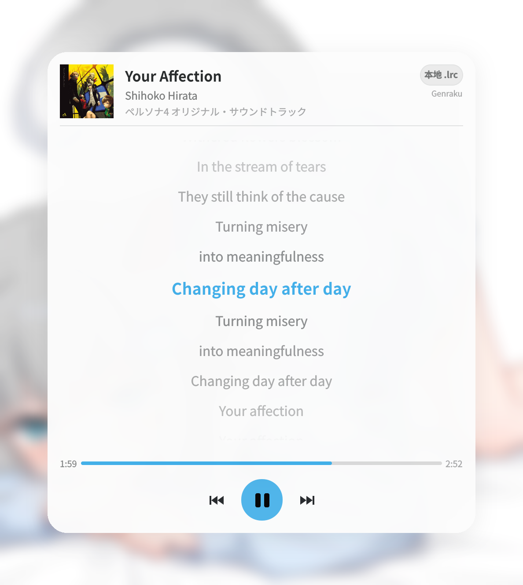
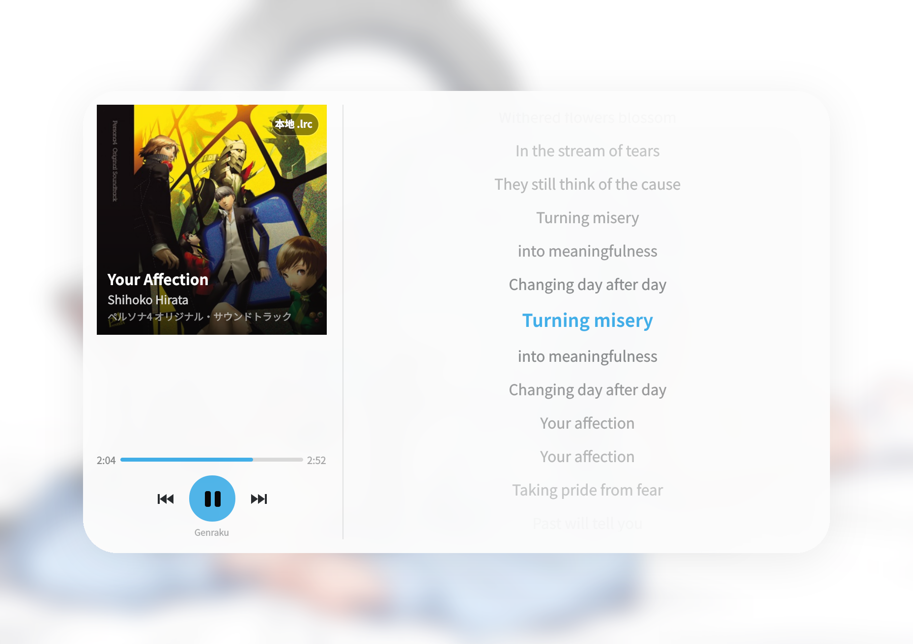

<div align="center">
  <h1 align="center">kde-lyricmon</h1>
  <p align="center">KDE Plasma 6 panel lyrics: the current line in your panel, cover art, scrolling lyrics and playback controls in the popup</p>
  <p align="center">English | <a href="README.md">中文</a></p>

  <a href="https://github.com/haoyn231/kde-lyricmon/releases/latest"></a>
  <a href="./LICENSE"></a>
  
  
  
  
  <br>
  <a href="https://github.com/haoyn231/kde-lyricmon/stargazers"></a>
</div>

---

<p align="center">
  
  &nbsp;
  
</p>

<p align="center"><sub>Two popup layouts: classic (left) and player (right), switchable in the settings; both show the track that was actually playing.</sub></p>

A KDE Plasma 6 plasmoid that shows the lyrics of whatever is playing, in the panel, with the current line highlighted. Click it for cover art, scrolling lyrics and playback controls.

All track information comes from [MPRIS 2.2](https://specifications.freedesktop.org/mpris-spec/latest/): any player that implements the spec (Spotify, VLC, Strawberry, Elisa, mpv, browser players…) just works — **there are no per-player adapters**. Lyrics come from the player itself (`xesam:asText`), then local `.lrc` files, then [LRCLIB](https://lrclib.net). Colours follow your system theme and accent colour.

## Features

- Panel: the current lyric line, optionally a second line for the next one; long lines scroll like a ticker
- The little music icon in front of the panel text can be turned off
- Falls back to the track title when there are no synced lyrics; collapses (icon only, or nothing) when nothing is playing
- Popup: cover art, title / artist / album, surrounding lyrics, seek bar, previous / play-pause / next
- Two popup layouts, switchable in the settings:
  - **Classic**: info on top, lyrics in the middle, seek bar and controls at the bottom
  - **Player**: a large cover on the left with the title / artist / album over it, seek bar and controls underneath, lyrics on the right
- Lyrics are centred and scrolled automatically; the current line is bold in the accent colour, distant lines fade out
- Click any lyric line to jump there (via MPRIS `SetPosition`, not simulated key presses)
- Dragging the seek bar only updates the display; the jump happens on release
- A source badge tells you whether the lyrics came from the player, a local file or LRCLIB
- Multiple players: playing > paused > has a track; players with album metadata win, and a browser tab starting playback no longer steals the panel
- Pin a specific player in the settings (matched by base service name, so it survives player restarts)
- Lyrics are cached on disk; switching songs back and forth does not hit the network again
- All lookups, network requests and image loads are asynchronous

## Install (KDE Plasma 6)

### From source

Dependencies (Arch Linux):

```bash
sudo pacman -S --needed base-devel cmake qt6-base qt6-declarative libplasma kirigami
```

Build and install for the current user (no root needed):

```bash
git clone https://github.com/haoyn231/kde-lyricmon.git
cd kde-lyricmon
./install.sh --restart
```

For development, `./install.sh --symlink` installs a symlink so QML edits only need a plasmashell restart (C++ changes still require a rebuild).

Then right-click the panel → **Enter Edit Mode** → **Add Widgets** → search **Desktop Lyrics** → drag it onto the panel.

Uninstall with `./uninstall.sh`. Lyrics cache lives in `~/.cache/kde-lyricmon/`.

## Usage

- The line in the panel is the current lyric.
- Click to expand the popup, click again to close.
- Click a lyric line or drag the seek bar to jump.
- Right-click the widget → **Configure** for the panel layout, the popup layout (classic / player), lyrics sources, extra lyrics directory, controls and the preferred player.

### Local lyrics

Supported names, looked up in `~/.lyrics`, `~/.local/share/lyrics`, the extra directory from the settings and next to the audio file:

```
<Artist> - <Title>.lrc
<Title> - <Artist>.lrc
<Title>.lrc
<Artist>/<Title>.lrc
<Artist>/<Album>/<Title>.lrc
```

Local players put the audio file in `xesam:url`, so a sibling `.lrc` next to the music file is picked up automatically.

## Where lyrics come from

| Order | Source | Notes |
| --- | --- | --- |
| 1 | MPRIS `xesam:asText` | Provided by the player, instant, usually plain text only |
| 2 | Local `.lrc` | Works offline, usually has timestamps |
| 3 | [LRCLIB](https://lrclib.net) | Online; `/api/get` first, then `/api/search` scored by title, artist, album and duration |

The important part: **when the player only provides plain text, the lookup continues** for a timestamped version. Plain text is shown immediately and replaced seamlessly when synced lyrics arrive.

Scoring (`src/lrcparser.cpp`): exact normalised title +70, contains +45; matching artist +25; matching album +5; duration within 2 s +15, within 5 s +8, off by >15 s −15; has synced lyrics +10. Anything below 60 is discarded.

Requests time out after 8 s; on failure the plain text stays and only a real absence is reported. The error state offers a retry button.

## How sync works

- Lyrics are parsed, sorted and de-duplicated (multiple timestamps per line, `[offset:]`, word-level `<mm:ss.xx>` tags are understood).
- `Position` is maintained in C++: extrapolated locally every 250 ms while playing and re-synced with the player every 4 s; the player wins only when the difference exceeds 600 ms. A `Seeked` signal snaps immediately.
- Seeking, track changes and pause/resume all re-locate the current line; pausing stops the clock and the lyrics with it.
- The current line is found with a binary search, without re-parsing anything.

## Theming

No colours are hardcoded: text uses `Kirigami.Theme.textColor`, accents use `Kirigami.Theme.highlightColor`, cards and badges are low-opacity derivatives of the text colour, and the primary button picks a light or dark glyph based on the accent's luminance.

Both hero images are light-theme 2x offscreen renders of the track that was actually playing — cover art, lyrics and playback position included, no fake player. Outside plasmashell there is no popup surface, so the previewer paints the popup background itself; that background is the only synthetic part.

`screenshot.png` is the classic portrait layout, `screenshot-player.png` the wide player layout (large cover on the left, lyrics on the right). Each is a `--light --square` render composited onto a blurred wallpaper with rounded corners and a drop shadow by `tools/compose_hero.py`. The player layout needs the wide render size or long lyric lines get clipped. Re-render both with `./tools/render-preview.sh` (it picks the currently playing music player, or set `PLAYER=...`).

## Development and testing

```
src/           C++ backend: MPRIS proxy, player registry, lyrics engine, LRC parser
package/       the plasmoid: metadata, config, QML
├── contents/ui/            panel and popup
├── contents/config/        KConfig definition and settings page
└── contents/lib/Hao/LyricMon build output lands here (qmldir + .so)
tools/         fake player, offscreen renderer, hero composer and screenshot script
tests/         QtTest unit tests
```

```bash
cmake --build build -j$(nproc)
ctest --test-dir build --output-on-failure
```

`tools/fakeplayer` is a scriptable MPRIS player whose position follows real time — useful for reproducing track changes, pause, seeking and "no lyrics" states deterministically:

```bash
./build/lyricmon-fake-player --title Yellow --artist Coldplay --album Parachutes \
    --duration 267 --position 100 --cover tools/assets/cover-demo.png
plasmawindowed org.hao.lyricmon
```

### Why is there a C++ plugin

Qt does not expose D-Bus to QML, so `PropertiesChanged` and friends are unreachable from a pure-QML plasmoid. The alternative — polling `dbus-send` or `playerctl` — makes position, seeking and multi-player switching slow and brittle. So only the D-Bus layer lives in a thin C++ plugin (`MprisPlayer`, `MprisRegistry`, `LyricsEngine`); QML contains no D-Bus or HTTP calls at all.

## Known limitations

- Plasma 6 only (Wayland and X11).
- No word-by-word (karaoke) highlighting; `<mm:ss.xx>` tags are stripped and lines sync as a whole.
- A few players always report `Position` as 0; the position is then extrapolated from the track change and may drift slightly over long playback.
- Browser players only report what the site gives them — often no artist or album, so lyrics go through fuzzy search.
- `xesam:asText` is not a standard channel for synced lyrics; formats vary (mostly plain text).

## Out of scope

No player, no lyrics editor, no non-public music platform APIs, no listening history, no telemetry, no speech recognition.

## License

MIT
