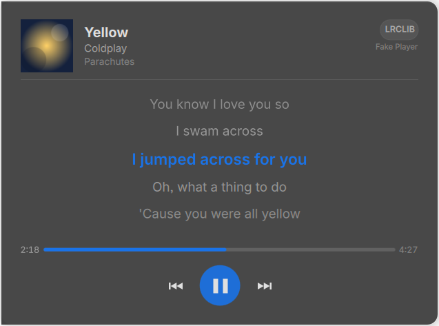
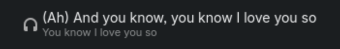

<div align="center">
  <h1 align="center">kde-lyrics</h1>
  <p align="center">KDE Plasma 6 面板歌词：菜单栏显示当前歌词，点开看封面、滚动歌词与播放控制</p>
  <p align="center"><a href="README.en.md">English</a> | 中文</p>

  <a href="https://github.com/haoyn231/kde-lyrics/releases/latest"></a>
  <a href="./LICENSE"></a>
  
  
  
  
  <br>
  <a href="https://github.com/haoyn231/kde-lyrics/stargazers"></a>
</div>

---

<p align="center">
  
</p>

<p align="center">
  
  &nbsp;&nbsp;
  
</p>

<p align="center"><sub>面板上只占一句话的位置（可选两行）；点开后是封面、当前歌词上下文、进度与上一首/播放/下一首</sub></p>

KDE Plasma 6 面板小程序（Plasmoid）：在菜单栏实时显示正在播放的歌词，点开后查看封面、滚动歌词与播放控制。

音乐信息全部来自 [MPRIS 2.2](https://specifications.freedesktop.org/mpris-spec/latest/)——只要播放器实现了标准接口（Spotify、VLC、Strawberry、Elisa、mpv、浏览器里的网页播放器……），插件就能用，**没有针对任何播放器写适配器**。歌词来源依次是播放器自带（`xesam:asText`）、本地 `.lrc`、[LRCLIB](https://lrclib.net)；配色完全跟随系统明暗主题与强调色。

## 功能

- 面板常驻：显示当前这一句歌词，可选第二行显示下一句；放不下时自动跑马灯滚动
- 没有同步歌词时回退到歌名，没有音乐时按配置收起（只留音符图标或完全隐藏）
- 点击展开：封面、歌名 / 艺术家 / 专辑、上下文若干句歌词、进度条、上一首 / 播放暂停 / 下一首
- 歌词居中滚动，当前句用强调色加粗；越远越淡，减少视觉噪音
- 点歌词任意一行直接跳到该句（走 MPRIS `SetPosition`，不是模拟按键）
- 拖动进度条松手才真正跳转，拖动过程中只更新显示
- 歌词来源徽标：一眼看出这句是播放器给的、本地文件，还是刚从 LRCLIB 拉的
- 多个 MPRIS 播放器同时存在时自动选择：正在播放 > 暂停 > 有曲目；带专辑信息的优先，且不会因为浏览器里开了个视频就把面板抢走
- 可在配置里固定某个播放器（按服务名匹配，播放器重启后实例号变化也能认出来）
- 歌词与封面有本地缓存，切歌来回切不会重复联网
- 歌词查询、网络请求、图片加载全部异步，UI 不会卡

## 安装（KDE Plasma 6）

### 方式一：从源码安装

依赖（Arch Linux）：

```bash
sudo pacman -S --needed base-devel cmake qt6-base qt6-declarative libplasma kirigami
```

编译并安装到当前用户（不需要 root）：

```bash
git clone https://github.com/haoyn231/kde-lyrics.git
cd kde-lyrics
./install.sh --restart
```

`install.sh` 会编译 C++ 插件、把整个包装到 `~/.local/share/plasma/plasmoids/org.hao.lyrics`，然后重启 plasmashell。

开发时改用软链接安装，改完 QML 重启 plasmashell 就能看到效果（C++ 改动仍需重新编译）：

```bash
./install.sh --symlink
```

### 方式二：手动安装

```bash
cmake -S . -B build -DCMAKE_BUILD_TYPE=Release
cmake --build build -j$(nproc)
mkdir -p ~/.local/share/plasma/plasmoids
cp -r package ~/.local/share/plasma/plasmoids/org.hao.lyrics
systemctl --user restart plasma-plasmashell.service
```

### 添加小组件

右键面板 → **进入编辑模式** → **添加小组件** → 搜索 **桌面歌词** / **Desktop Lyrics** → 拖到面板上。

卸载：

```bash
./uninstall.sh
systemctl --user restart plasma-plasmashell.service
```

歌词缓存在 `~/.cache/kde-lyrics/`，卸载不会自动删除。

## 使用

- 面板上的那句话就是当前歌词；没在播放时默认收起。
- 点一下展开弹窗，再点一下收起。
- 弹窗里点任意一句歌词，直接跳到那一句；拖进度条同理。
- 右键小组件 → **配置**：
  - 面板：单行 / 双行、是否显示音符图标、无音乐时是否收起、最大宽度、字号
  - 歌词来源：播放器自带 / 本地 `.lrc` / LRCLIB 三个开关，以及额外的歌词目录
  - 弹窗：是否显示播放控制
  - 跟随播放器：默认「自动（正在播放的那个）」，也可以固定某一个

### 本地歌词怎么放

支持这些命名（`~/.lyrics`、`~/.local/share/lyrics`、配置里的额外目录，以及音频文件同目录）：

```
〈艺术家〉 - 〈歌名〉.lrc
〈歌名〉 - 〈艺术家〉.lrc
〈歌名〉.lrc
〈艺术家〉/〈歌名〉.lrc
〈艺术家〉/〈专辑〉/〈歌名〉.lrc
```

本地播放器（Strawberry、Elisa 等）会把音频文件路径放在 `xesam:url` 里，插件会顺手找同目录下的同名 `.lrc`——把歌词文件丢在音乐文件旁边就能用。

## 歌词从哪来

| 顺序 | 来源 | 说明 |
| --- | --- | --- |
| 1 | MPRIS `xesam:asText` | 播放器自己提供的歌词，最快，通常只有纯文本 |
| 2 | 本地 `.lrc` | 离线可用，一般带时间轴 |
| 3 | [LRCLIB](https://lrclib.net) | 在线，`/api/get` 精确匹配失败后走 `/api/search` 并按标题、艺术家、专辑、时长打分 |

关键一点：**播放器只给了纯文本时，仍会继续找带时间轴的版本**。拿到纯文本立刻显示，找到同步歌词再无缝替换——不会因为播放器塞了一段纯文本就失去滚动能力。

匹配评分（`src/lrcparser.cpp`）：标题归一化后完全相同 +70，包含 +45；艺术家匹配 +25；专辑匹配 +5；时长差 ≤2 秒 +15、≤5 秒 +8、>15 秒 −15；带同步歌词 +10。低于 60 分不采用。

请求超时 8 秒，失败时如果有纯文本就继续显示，没有才报错；错误态可以点「重新获取」。

## 同步是怎么算的

- 歌词按 LRC 时间戳解析、排序、去重（支持一行多时间戳、`[offset:]`、逐字标签 `<mm:ss.xx>`）。
- `Position` 由 C++ 侧维护：播放中每 250ms 本地推算一次，每 4 秒和播放器对一次表；偏差超过 600ms 才以播放器为准（避免来回抖）。收到 `Seeked` 信号立刻对齐。
- 拖动进度、切歌、暂停恢复都会重新定位当前句；暂停时进度不再前进，歌词自然停住。
- 当前句用二分查找定位，播放中不会重新解析歌词。

## 主题

没有写死任何前景色或背景色：

- 文字：`Kirigami.Theme.textColor`，次要信息按透明度派生
- 强调色（当前歌词、进度条、主按钮）：`Kirigami.Theme.highlightColor`
- 卡片、徽标、分隔线：由 `textColor` 派生极低透明度
- 主按钮的图标颜色按强调色亮度自动选深/浅，强调色换成亮黄也看得清

`docs/images/screenshot.png` 是在 Orchis-dark 主题下、真实 plasmashell 环境里截的；两张面板图是离屏渲染，用同一套深色配色，所以两者看起来是一组。

想自己出图：

```bash
cmake --build build -j$(nproc)
./tools/render-preview.sh          # 面板两张图写进 docs/images/
```

## 开发与测试

```
src/           C++ 后端：MPRIS 代理、播放器注册表、歌词引擎、LRC 解析
package/       小程序本体：metadata、配置、QML
├── contents/ui/            面板与弹窗
├── contents/config/        KConfig 定义与配置页
└── contents/lib/Hao/Lyrics 编译产物落在这里（qmldir + .so）
tools/         假播放器、离屏渲染、出图脚本
tests/         QtTest 单元测试
```

单元测试（LRC 解析、归一化、匹配评分）：

```bash
cmake --build build -j$(nproc)
ctest --test-dir build --output-on-failure
```

`tools/fakeplayer` 是一个可以被随意摆布的 MPRIS 播放器：位置随真实时间走，能指定曲目、时长、封面、`xesam:asText`，也可以从任意位置起播，用来复现「切歌 / 暂停 / 拖动 / 无歌词」这些不好用真播放器复现的场景：

```bash
./build/lyrics-fake-player --title Yellow --artist Coldplay --album Parachutes \
    --duration 267 --position 100 --cover tools/assets/cover-demo.png
plasmawindowed org.hao.lyrics
```

### 为什么有一个 C++ 插件

Qt 没有把 D-Bus 暴露给 QML，纯 QML 拿不到 `PropertiesChanged` 这类信号。可选方案是定时跑 `dbus-send`／`playerctl` 之类的外部进程，但那会让进度、跳转、多播放器切换变得又慢又脆。所以这里只把「D-Bus 这一层」放进一个很薄的 C++ 插件里：

- `MprisPlayer`：一个播放器代理，摊平属性、推算进度、转发控制方法
- `MprisRegistry`：发现 / 移除播放器，决定当前显示哪一个
- `LyricsEngine`：歌词来源链、解析、缓存、匹配
- QML 里只有界面，没有任何 D-Bus 和 HTTP 调用

## 已知限制

- 只支持 Plasma 6（Wayland / X11 都行），没有做其他桌面环境的打包。
- 逐字（卡拉 OK 式）歌词暂不支持：`<mm:ss.xx>` 标签会被去掉，按整行同步。
- 极少数播放器的 `Position` 始终返回 0，此时进度从切歌时刻起本地推算，长时间播放可能有轻微漂移。
- 浏览器里的网页播放器能给的信息取决于网站，很多时候没有艺术家/专辑，歌词会走模糊搜索。
- `xesam:asText` 不是标准的「同步歌词」通道，各播放器给的格式五花八门（纯文本居多）。

## 不做的事

不做播放器、不做歌词编辑器、不接非公开的音乐平台 API、不上传播放历史、没有遥测、第一版不引入语音识别。

## License

MIT
